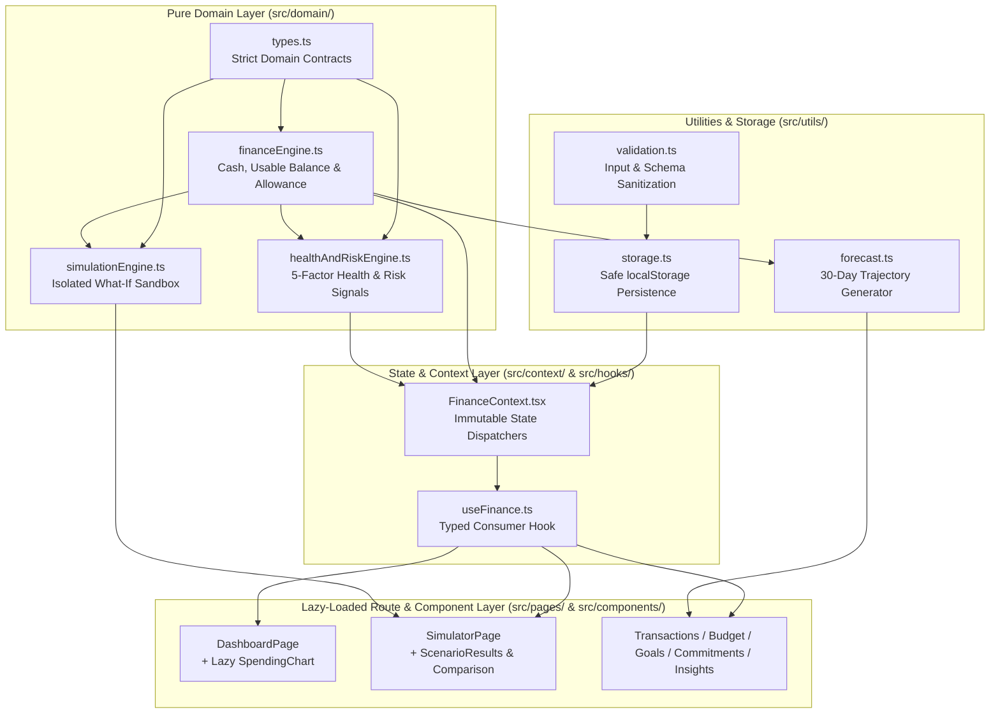

# PaisaPilot — Interactive Personal Finance Simulator

> *"Your money. Your decisions. Your future."*

**PaisaPilot** is a local-first, interactive personal finance decision simulator engineered for Gen Z students, interns, and early-career professionals managing tight monthly budgets (defaulting to a realistic **₹10,000 / 30-day cycle**). Unlike passive expense trackers that only report money after it is gone, PaisaPilot connects **liquid cash**, **ring-fenced bill obligations**, **locked savings goals**, **dynamic daily spending allowances**, and an **explainable 0–100 financial health index** around a **What-If Decision Simulator**.

Live Deployment:
- **Netlify Production**: [https://paisapilot-simulator.netlify.app](https://paisapilot-simulator.netlify.app)
- **GitHub Pages**: [https://shivam07266.github.io/paisapilot/](https://shivam07266.github.io/paisapilot/)

---

## 📑 Table of Contents

1. [Problem Statement & Target User](#1-problem-statement--target-user)
2. [Key Features](#2-key-features)
3. [Core Financial Logic & Accounting Model](#3-core-financial-logic--accounting-model)
4. [What-If Simulator Behavior & Decision Clarity](#4-what-if-simulator-behavior--decision-clarity)
5. [Explainable Financial Health Score (0–100)](#5-explainable-financial-health-score-0100)
6. [Technology Stack](#6-technology-stack)
7. [Architecture Overview](#7-architecture-overview)
8. [Actual Directory Structure](#8-actual-directory-structure)
9. [Local Setup & Installation](#9-local-setup--installation)
10. [Available npm Scripts](#10-available-npm-scripts)
11. [Usage Walkthrough](#11-usage-walkthrough)
12. [Accessibility Features (WCAG 2.1 AA)](#12-accessibility-features-wcag-21-aa)
13. [Performance Engineering Approach](#13-performance-engineering-approach)
14. [Data Persistence & Privacy Model](#14-data-persistence--privacy-model)
15. [Security & Validation Approach](#15-security--validation-approach)
16. [Testing Strategy & Verification](#16-testing-strategy--verification)
17. [Known Limitations & Scope Boundaries](#17-known-limitations--scope-boundaries)
18. [Future Enhancements](#18-future-enhancements)

---

## 1. Problem Statement & Target User

### The Problem
Students and young earners frequently experience mid-month cash crunches because traditional bank balances conflate **total cash on hand** with **discretionary spendable cash**. When a user sees ₹6,500 in their account on the 15th of the month, they may impulse-buy ₹2,000 wireless headphones—forgetting that ₹1,500 is owed for rent/Wi-Fi bills next week and ₹1,500 was meant for an emergency buffer.

### Target User
- **College students & hostel residents** managing monthly allowances (`₹10,000/month`).
- **Interns, freelancers, and first-job earners** balancing irregular gig income, subscriptions, category envelopes, and short-term savings targets.

---

## 2. Key Features

- **Financial Cockpit Dashboard**: Real-time visibility into Usable Balance, Current Cash, Daily Safe Spend Allowance, Burn Rate per Day, Upcoming Obligations, Savings Progress, and Category Spend Distribution.
- **Zero-Risk What-If Decision Simulator**:
  - 5 one-click Gen Z presets (*Wireless Headphones ₹2,000*, *Weekend Social Outing ₹800*, *Monthly Streaming Bundle ₹499*, *Tech Certification Course ₹1,500*, *Urgent Laptop Screen Repair ₹2,500*) plus custom scenario modeling.
  - Side-by-side **Before vs. After** impact across **5 dimensions**: Usable Balance, Daily Safe Spend, Projected Month-End Balance, Financial Risk Level, and Health Score.
  - **Decision Clarity & Trade-off Pathways**: Compares *Spend Now*, *Trim 30%*, and *14-Day Micro-Save Delay* pathways alongside **Option A vs. Option B** comparison.
- **Full Transaction Ledger**: Add, edit, delete, search (with React `useDeferredValue`), and filter income and expenses across 8 expense and 5 income categories.
- **Category Budget Envelopes**: Configurable monthly spending limits per category with visual threshold alerts (`Within Budget`, `Near Limit ≥80%`, `Over Budget >100%`).
- **Ring-Fenced Savings Goals**: Create goals, contribute from usable cash, or withdraw back to usable liquidity with strict balance guards.
- **Commitments & Subscription Manager**: Reserve funds for upcoming one-time, weekly, or monthly obligations and settle them with one click (`Pay Now`) without double-deducting.
- **30-Day Cash Trajectory Forecast & Risk Engine**: Interactive trajectory chart with accessible screen-reader data table, active risk signals, and actionable interventions.

---

## 3. Core Financial Logic & Accounting Model

All financial calculations are implemented as pure, deterministic functions in `src/domain/financeEngine.ts`, `src/domain/healthAndRiskEngine.ts`, and `src/domain/simulationEngine.ts`.

### Fundamental Accounting Equations

1. **Current Total Cash**:
   $$\text{Current Cash} = \text{Starting Budget} + \sum \text{Received Income} - \sum \text{Paid Expenses}$$

2. **Ring-Fenced Usable Discretionary Balance**:
   $$\text{Usable Balance} = \text{Current Cash} - \sum \text{Unpaid Commitments} - \sum \text{Savings Goal Balances}$$

3. **Dynamic Daily Safe Spending Allowance**:
   $$\text{Daily Allowance} = \max\left(0,\; \frac{\text{Usable Balance}}{\max(1, \text{Days Remaining in Period})}\right)$$

4. **Projected Month-End Balance**:
   $$\text{Projected End Balance} = \text{Current Cash} - \sum \text{Unpaid Commitments} - (\text{Estimated Future Daily Spend} \times \text{Days Remaining})$$

### Accounting Invariants
- **Zero Double-Counting on Bill Settlement**: While a commitment is `upcoming` or `overdue`, its amount is deducted from `Usable Balance` (reserved) but remains in `Current Cash`. When the user clicks **Pay Now**, the commitment transitions to `paid` (releasing the reservation) and a corresponding `expense` transaction is appended—reducing `Current Cash` by the exact same amount so `Usable Balance` remains invariant.
- **Internal Savings Ring-Fencing**: Contributing to a savings goal transfers funds from `Usable Balance` into `Savings Reserved` without creating a fake external expense transaction; `Current Cash` remains unchanged because the money is still owned by the user.

---

## 4. What-If Simulator Behavior & Decision Clarity

The What-If Simulator (`src/domain/simulationEngine.ts`) operates as an isolated, side-effect-free sandbox:

1. **In-Memory State Cloning**: `simulateScenario(state, scenario)` constructs a synthetic ledger containing the proposed transaction. If `scenario.isRecurring` is enabled, it also models a recurring commitment reservation for the next cycle.
2. **Delta Computation**: Computes exact paise-rounded (`Math.round(x * 100) / 100`) deltas for:
   - `usableBalanceDelta`
   - `dailyAllowanceDelta`
   - `endBalanceDelta`
   - `healthScoreShift` and `riskLevelShift`
3. **Verdict Classification**:
   - `safe`: Usable balance remains positive, risk is low/moderate, and category budget is respected.
   - `caution`: Purchase consumes $>35\%$ of usable cash, breaches a category envelope, or elevates risk.
   - `danger`: Purchase drives usable balance negative, threatens unpaid bill coverage, or triggers critical risk.
4. **Explicit Confirmation**: Previewing or resetting a scenario **never** mutates `FinanceContext` or `localStorage`. Only clicking **Apply to Actual Finances** and confirming the modal logs the expense once.

---

## 5. Explainable Financial Health Score (0–100)

Computed in `src/domain/healthAndRiskEngine.ts`, the health score is broken down into **5 transparent factors** totaling **100 points**:

| Factor | Max Points | Weight | Evaluation Logic |
|---|---:|---:|---|
| **Budget Sustainability** | 30 | 30% | Ratio of `usableBalance` to total resource pool (`startingBudget + receivedIncome`). |
| **Spending Discipline** | 25 | 25% | Adherence to category budget limits; penalizes breached (`>100%`) or strained (`>85%`) envelopes. |
| **Commitment Coverage** | 20 | 20% | Verifies `currentCash >= unpaidCommitmentsReserved` plus post-obligation liquidity margin. |
| **Emergency Cushion** | 15 | 15% | Evaluates whether liquid reserves after obligations meet the $\ge 15\%$ safety buffer target. |
| **Savings Feasibility** | 10 | 10% | Measures active progress (`currentAmount / targetAmount`) across user savings goals. |

**Status Tiers**:
- **80–100**: `Healthy`
- **60–79**: `Stable`
- **40–59**: `Caution`
- **0–39**: `At Risk`

---

## 6. Technology Stack

| Layer | Technology | Version | Purpose |
|---|---|---|---|
| **UI Library** | React | `^19.2.4` | Component architecture, hooks, Suspense & concurrent rendering |
| **Language** | TypeScript | `~5.9.3` | Strict static typing (`strict: true`, zero `any`) |
| **Build Tool** | Vite | `^8.0.1` | Fast HMR, ESM bundling, and manual vendor chunk splitting |
| **Styling** | Tailwind CSS | `^4.2.1` | Dark-navy financial UI system and responsive layout utilities |
| **Routing** | React Router DOM | `^7.13.1` | Client-side SPA routing with lazy-loaded route boundaries |
| **Charts** | Recharts | `^3.8.0` | Responsive category donut chart & 30-day forecast trajectory |
| **Icons** | Lucide React | `^1.7.0` | Accessible vector iconography |
| **Linter** | Oxlint | `^1.56.0` | High-speed AST static analysis (zero warnings, zero errors) |
| **Testing** | Vitest + Testing Library | `^4.1.0` | Automated unit, domain, validation, and component test suite |

---

## 7. Architecture Overview

PaisaPilot follows a clean, layered frontend architecture that strictly separates **pure domain logic**, **validated persistence**, **state orchestration**, and **presentational UI**.



---

## 8. Actual Directory Structure

```text
paisapilot/
├── public/
│   └── favicon.svg                        # Branded ₹P vector icon
├── src/
│   ├── components/
│   │   ├── commitments/
│   │   │   ├── CommitmentFormModal.tsx    # Validated modal to add upcoming bills
│   │   │   └── CommitmentList.tsx         # Memoized upcoming & settled obligations list
│   │   ├── dashboard/
│   │   │   ├── BalanceCard.tsx            # Memoized Usable Balance & cash breakdown card
│   │   │   ├── DailyAllowanceCard.tsx     # Memoized daily safe spend & burn rate card
│   │   │   ├── HealthScoreCard.tsx        # Memoized SVG score ring & 5-factor breakdown
│   │   │   └── SpendingChart.tsx          # Lazy-loaded category donut chart & progress bars
│   │   ├── goals/
│   │   │   ├── GoalCard.tsx               # Memoized savings goal card with contribute/withdraw
│   │   │   └── GoalFormModal.tsx          # Validated modal to create new savings targets
│   │   ├── layout/
│   │   │   ├── AppShell.tsx               # Skip-to-content link, top status bar, reset modal
│   │   │   ├── MobileNav.tsx              # Accessible mobile drawer (Escape key) & bottom bar
│   │   │   └── Sidebar.tsx                # Memoized desktop sidebar navigation & cash snapshot
│   │   ├── simulator/
│   │   │   ├── ScenarioComparison.tsx     # Option A vs. Option B side-by-side comparison
│   │   │   ├── ScenarioResults.tsx        # 5-metric delta cards & 3-path Decision Clarity Matrix
│   │   │   └── SimulatorForm.tsx          # Gen Z quick presets & custom scenario form
│   │   ├── transactions/
│   │   │   ├── TransactionForm.tsx        # Accessible income/expense form with field validation
│   │   │   └── TransactionList.tsx        # Searchable (useDeferredValue) & filterable ledger
│   │   └── ui/
│   │       ├── Badge.tsx                  # Semantic status & category badges
│   │       ├── Button.tsx                 # Accessible button primitive with focus rings
│   │       ├── Card.tsx                   # Dark-navy surface container primitive
│   │       ├── EmptyState.tsx             # Accessible fallback state component
│   │       ├── ErrorBoundary.tsx          # Runtime crash recovery boundary with state reset
│   │       ├── Modal.tsx                  # Focus-trapped ARIA dialog with useId & Escape handler
│   │       └── ProgressBar.tsx            # Semantic ARIA progressbar component
│   ├── context/
│   │   └── FinanceContext.tsx             # React context provider & state mutation handlers
│   ├── data/
│   │   └── demoData.ts                    # Realistic ₹10,000 30-day Gen Z seed dataset
│   ├── domain/
│   │   ├── financeEngine.ts               # Core cash, usable balance & allowance calculations
│   │   ├── healthAndRiskEngine.ts         # 5-factor health score & risk level evaluator
│   │   ├── index.ts                       # Domain barrel exports
│   │   ├── simulationEngine.ts            # Pure What-If scenario simulation engine
│   │   └── types.ts                       # Strict TypeScript interfaces & union types
│   ├── hooks/
│   │   └── useFinance.ts                  # Custom hook exposing FinanceContext
│   ├── pages/
│   │   ├── BudgetPage.tsx                 # Category spending limits & breach warnings
│   │   ├── CommitmentsPage.tsx            # Upcoming bills & subscriptions page
│   │   ├── DashboardPage.tsx              # Main financial cockpit page
│   │   ├── GoalsPage.tsx                  # Savings goals & ring-fenced buffers page
│   │   ├── InsightsPage.tsx               # 30-day forecast chart & risk intelligence page
│   │   ├── SimulatorPage.tsx              # What-If financial decision sandbox page
│   │   └── TransactionsPage.tsx           # Full income & expense ledger page
│   ├── test/
│   │   ├── components.test.tsx            # UI primitive & component interaction tests
│   │   ├── financeEngine.test.ts          # Core accounting & health score unit tests
│   │   ├── setup.ts                       # Vitest + jest-dom test environment setup
│   │   ├── simulator.test.ts              # Simulation isolation, deltas & recurring tests
│   │   └── validation.test.ts             # Input validation & corrupt storage recovery tests
│   ├── utils/
│   │   ├── forecast.ts                    # 30-day daily balance projection generator
│   │   ├── formatting.ts                  # en-IN Rupee (₹) & date formatting helpers
│   │   ├── storage.ts                     # Safe localStorage read/write/export utilities
│   │   └── validation.ts                  # Strict input validators & state sanitizer
│   ├── App.tsx                            # Route definitions with React.lazy code splitting
│   ├── index.css                          # Tailwind v4 imports, scrollbars & reduced-motion rules
│   └── main.tsx                           # Application root mount
├── index.html                             # HTML5 entry with SEO & OpenGraph metadata
├── package.json                           # Scripts & minimal production dependencies
├── tsconfig.app.json                      # Strict TypeScript compiler configuration
├── tsconfig.json                          # Composite TypeScript project references
├── tsconfig.node.json                     # Node/Vite TypeScript configuration
├── vite.config.ts                         # Vite bundler & manual chunk splitting config
└── vitest.config.ts                       # Vitest JSDOM test runner configuration
```

---

## 9. Local Setup & Installation

### Prerequisites
- **Node.js**: `v18.0.0` or higher (`v20+` LTS recommended)
- **npm**: `v9.0.0` or higher

### Step-by-Step Setup

```bash
# 1. Clone the repository
git clone https://github.com/shivam07266/paisapilot.git
cd paisapilot

# 2. Install dependencies
npm install

# 3. Start the local development server
npm run dev
```

Open `http://localhost:5173` in your browser. The app initializes automatically with a realistic ₹10,000 monthly Gen Z student dataset.

---

## 10. Available npm Scripts

| Script | Command | Description |
|---|---|---|
| `npm run dev` | `vite` | Launches the Vite development server with HMR at `http://localhost:5173`. |
| `npm run build` | `tsc -b && vite build` | Runs strict TypeScript project-reference verification followed by production bundling into `dist/`. |
| `npm run preview` | `vite preview` | Serves the production build locally for pre-deployment verification. |
| `npm test` | `vitest run` | Executes the complete Vitest suite once in headless JSDOM mode. |
| `npm run test:watch` | `vitest` | Runs Vitest in interactive watch mode during development. |
| `npm run lint` | `oxlint src` | Runs Oxlint static analysis across `src/` for code quality and correctness. |
| `npm run typecheck` | `tsc -b` | Runs standalone TypeScript compiler verification across all project references. |

---

## 11. Usage Walkthrough

1. **Inspect Your True Spendable Cash (`Dashboard`)**:
   - Observe the difference between **Current Total Cash** and **Usable Balance** (which automatically subtracts unpaid commitments and locked savings goals).
   - Click **"How is this calculated?"** on the **Financial Health Index** card to inspect all 5 weighted scoring factors.
2. **Test a Purchase Before Spending (`What-If Simulator`)**:
   - Click a preset (e.g., *Wireless Headphones — ₹2,000*) or enter a custom expense.
   - Review the **5-card Before vs. After comparison** (Usable Balance, Daily Safe Spend, Projected Month-End Balance, Risk Level, Health Score) and the **Decision Clarity & Trade-off Pathways** (*Spend Now*, *Trim 30%*, *14-Day Micro-Save*).
   - Toggle **"Compare with Cheaper Alternative"** to evaluate Option A vs. Option B side by side.
   - Click **"Apply to Actual Finances"** only if you want to commit the expense to your real ledger.
3. **Manage Transactions, Envelopes, Goals & Bills**:
   - **Transactions**: Log income or expenses, search in real time, or filter by type and category.
   - **Category Budgets**: Adjust monthly category limits and monitor percentage utilization.
   - **Savings Goals**: Contribute usable cash into ring-fenced goals or withdraw funds back when needed.
   - **Commitments**: Add recurring or one-time bills and click **Pay Now** when settled.

---

## 12. Accessibility Features (WCAG 2.1 AA)

- **Keyboard Navigation & Focus Management**:
  - Dedicated **"Skip to main content"** link (`#main-content`) as the first focusable element in `AppShell.tsx`.
  - Custom `Modal` component implements an active **Tab / Shift+Tab focus trap**, **Escape key dismissal**, collision-free `useId()` ARIA labeling (`aria-labelledby`, `aria-describedby`), and **automatic focus restoration** to the trigger button on close.
  - Mobile navigation drawer supports `Escape` key dismissal and `aria-expanded` state announcements.
- **Semantic Landmarks & Heading Hierarchy**:
  - Proper `<aside aria-label="Main Navigation">`, `<nav aria-label="Primary Sidebar Navigation">`, `<header>`, `<main id="main-content">`, and `<section>` landmarks.
  - Strict single-`<h1>` per page with sequential `<h2>` section headings.
- **Screen-Reader Data Equivalents**:
  - Every `ProgressBar` and health factor bar exposes `role="progressbar"`, `aria-valuenow`, `aria-valuemin`, `aria-valuemax`, and `aria-label`.
  - Visual charts (`SpendingChart` and `InsightsPage` 30-day `LineChart`) include `role="img"` labels plus structured breakdown lists or `<table className="sr-only">` data equivalents.
- **Color Contrast & Motion Sensitivity**:
  - High-contrast typography (`text-slate-100` to `text-slate-400` on `#080d1a` / `#0f172a` surfaces) paired with explicit text badges and icons so status is never conveyed by color alone.
  - Global `@media (prefers-reduced-motion: reduce)` rule in `src/index.css` disables non-essential animations for motion-sensitive users.

---

## 13. Performance Engineering Approach

- **Route & Chart Code Splitting**:
  - All 6 secondary routes (`SimulatorPage`, `TransactionsPage`, `BudgetPage`, `GoalsPage`, `CommitmentsPage`, `InsightsPage`) are lazy-loaded via `React.lazy` and `Suspense`.
  - `SpendingChart` on the Dashboard is lazy-loaded so the heavy `recharts` (`vendor-charts`) bundle is **excluded from the initial critical-path HTML preload** and fetched asynchronously after the primary financial KPIs paint.
- **Vendor Chunk Isolation (`vite.config.ts`)**:
  - Separates `vendor-react`, `vendor-charts`, and `vendor-icons` into dedicated cacheable chunks.
- **Render & State Optimization**:
  - Pure domain calculations in `FinanceContext` (`summary`, `risk`, `health`) are memoized via `useMemo`.
  - Presentational cards and lists (`BalanceCard`, `DailyAllowanceCard`, `HealthScoreCard`, `SpendingChart`, `TransactionList`, `CommitmentList`, `GoalCard`, `Sidebar`, `MobileNav`, `SimulatorForm`, `ScenarioResults`, `ScenarioComparison`) are wrapped in `React.memo`.
  - `TransactionList` uses React 19 `useDeferredValue` for non-blocking search filtering.

---

## 14. Data Persistence & Privacy Model

- **100% Local-First Privacy**: All financial data stays strictly inside the user's browser under the versioned key `paisapilot_state_v1` in `localStorage`. Zero external servers, analytics trackers, or third-party APIs receive user financial data.
- **Resilient Hydration**: On startup, `loadStateFromStorage()` parses and sanitizes stored JSON via `sanitizeAppState()`. If storage is empty, malformed, or tampered with, the application seamlessly falls back to `createInitialDemoState()` without throwing runtime errors.
- **Portability & Reset Controls**: Users can export a complete, timestamped JSON backup (`paisapilot-backup-YYYY-MM-DD.json`) or reset to the clean ₹10,000 demo state at any time from the sidebar or mobile menu.

---

## 15. Security & Validation Approach

- **Strict Input Validation (`src/utils/validation.ts`)**:
  - Rejects `NaN`, `Infinity`, negative or zero transaction amounts, amounts exceeding `₹1,00,00,000` (`MAX_SAFE_AMOUNT`), malformed calendar dates, and unapproved category strings.
  - Truncates text descriptions (`≤120` chars) and notes (`≤300` chars) to prevent UI overflow and storage abuse.
- **Prototype Pollution & Deserialization Hardening**:
  - `sanitizeAppState()` verifies plain object prototypes and reconstructs every entity (`Transaction`, `SavingsGoal`, `Commitment`, `CategoryBudget`) field-by-field against strict allowlists before state hydration.
- **XSS Prevention**:
  - Zero usage of `dangerouslySetInnerHTML`, `eval()`, or `innerHTML`. All user-supplied strings are safely escaped by React JSX.

---

## 16. Testing Strategy & Verification

PaisaPilot is verified by **19 automated tests across 4 test suites** in `src/test/` using **Vitest** and **React Testing Library**:

- `src/test/financeEngine.test.ts` (9 tests): Verifies Current Cash, Usable Balance, Daily Allowance (including zero-day and negative-balance edge cases), commitment payment reservation release without double-counting, savings ring-fencing, health score factor weights, risk boundaries, and burn rate projections.
- `src/test/simulator.test.ts` (4 tests): Verifies strict state immutability during What-If simulations, exact delta computations, deficit danger verdicts, and recurring commitment simulation.
- `src/test/validation.test.ts` (5 tests): Verifies amount/date validators, form error reporting, corrupted `localStorage` recovery, and prototype pollution rejection.
- `src/test/components.test.tsx` (7 tests): Verifies `Button`, `ProgressBar` ARIA attributes, `Modal` Escape key & dialog semantics, `EmptyState`, `BalanceCard` INR formatting, `GoalCard` usable-balance contribution guards, and `TransactionList` search filtering & deletion confirmation.

Run all checks locally:
```bash
npm run typecheck
npm run lint
npm test
npm run build
```

---

## 17. Known Limitations & Scope Boundaries

- **Single-Currency (INR `₹`)**: Designed specifically around Indian Rupee formatting (`en-IN`) and student/young-professional budgeting workflows.
- **Single-Device Local Storage**: Because PaisaPilot is intentionally local-first and requires zero account sign-up, state does not automatically sync across separate devices unless exported/imported via JSON backup.
- **Deterministic Linear Pacing**: The 30-day forecast projects discretionary daily spend linearly using the current daily allowance and exact commitment due dates rather than probabilistic machine-learning predictions.

---

## 18. Future Enhancements

- **JSON Backup Import / Restore Modal**: Allow drag-and-drop restoration of exported `paisapilot-backup.json` snapshots.
- **Multi-Cycle Archive & Month-over-Month Comparison**: Compare historical 30-day budget cycles to track long-term health score improvements.
- **Installable PWA Offline Service Worker**: Add a web app manifest and service worker for offline home-screen installation on mobile devices.
